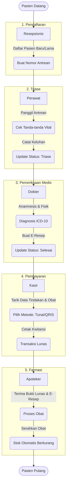

# 🏥 Sistem Informasi Klinik Terpadu (Clinic Information System)

Aplikasi Sistem Informasi Klinik berbasis Web dan Mobile-responsive. Dibangun untuk mendigitalisasi seluruh proses operasional klinik, mulai dari pendaftaran pasien, rekam medis elektronik, manajemen antrean *real-time*, hingga kasir dan apotek.

## 🔄 Alur Kerja Sistem (Workflow)



## ✨ Fitur Berdasarkan Peran (Role)

1. **Resepsionis (Pendaftaran)**
   * Manajemen Data Pasien (CRUD).
   * Pembuatan Antrean Poli.
   * Pencetakan Tiket Antrean (*Thermal Print*).
2. **Perawat (Triase)**
   * Pemantauan Antrean (Status: Menunggu).
   * Input Pemeriksaan Awal (Tensi, Suhu, Nadi, Berat/Tinggi, Keluhan).
3. **Dokter (Pemeriksaan)**
   * Dasbor Antrean Pasien Dokter.
   * Rekam Medis Elektronik (Riwayat Pasien, Diagnosis ICD-10).
   * Pembuatan *E-Prescription* (Resep Obat Digital).
4. **Kasir (Pembayaran)**
   * Kalkulasi otomatis biaya tindakan dan resep obat.
   * Integrasi Pembayaran QRIS Dinamis (Midtrans).
   * Cetak Kwitansi/Invoice (A4 & Thermal).
5. **Apoteker (Farmasi)**
   * Notifikasi Resep Masuk secara *Real-time*.
   * Pemrosesan Resep & Cetak Label/Etiket Obat.
   * Manajemen Stok Obat (Otomatis berkurang saat resep diselesaikan).
6. **Administrator**
   * Manajemen Pengguna & Hak Akses (Role-based).
   * Laporan Pendapatan & Kunjungan (Chart & Export Excel).
   * Manajemen Master Data (Tarif Tindakan, Kategori Obat).

---

## 🛠️ Teknologi & Packages (Tech Stack)

Sistem ini memisahkan antara Backend (API) dan Frontend (SPA).

### Backend (Laravel 11 & PHP 8.2+)
* **Framework:** Laravel 11
* **Database:** MySQL
* **Real-time WebSockets:** `laravel/reverb`
* **Authentication:** `laravel/sanctum`
* **Role & Permission:** `spatie/laravel-permission`
* **Payment Gateway (QRIS):** `midtrans/midtrans-php`
* **Cetak PDF:** `barryvdh/laravel-dompdf`
* **Export Excel:** `maatwebsite/excel`

### Frontend (React 18 & Vite)
* **Framework:** React.js v18 (Vite)
* **Styling:** Tailwind CSS (Responsive Web & Mobile)
* **State Management:** `zustand`
* **Data Fetching & Caching:** `@tanstack/react-query`
* **Form & Validation:** `react-hook-form` + `zod`
* **WebSockets Client:** `laravel-echo` + `pusher-js`
* **Routing:** `react-router-dom`
* **Printing Component:** `react-to-print`
* **Charts:** `recharts`
* **Notifications:** `react-hot-toast`

---

## 🚀 Panduan Instalasi & Menjalankan Aplikasi

### Persyaratan Sistem
* PHP 8.2 atau lebih baru
* Composer
* Node.js v18+ & NPM
* MySQL Server (XAMPP / Laragon / Native)

### 1. Setup Database (Memasukkan File MySQL Anda)
Anda bisa membuat struktur tabel menggunakan file `.sql` yang Anda miliki, atau menggunakan *migration* bawaan:

**Opsi A: Menggunakan File `.sql` Anda (Import Manual)**
1. Buka phpMyAdmin (biasanya di `http://localhost/phpmyadmin`).
2. Buat database baru dengan nama `klinik` (atau nama lain sesuai keinginan).
3. Klik database tersebut, lalu pilih tab **Import**.
4. Masukkan/unggah file `.sql` milik Anda yang berisi *code table*, lalu klik **Go**.

**Opsi B: Menggunakan Laravel Migration (Rekomendasi)**
1. Buat database kosong bernama `klinik`.
2. Anda tidak perlu mengimpor file `.sql` apapun. (Tabel akan dibuat secara otomatis di Langkah 2).

### 2. Setup Backend (Laravel API)
Buka terminal dan arahkan ke folder `backend`:
```bash
cd backend
composer install
cp .env.example .env
php artisan key:generate
```
Buka file `.env` dan sesuaikan konfigurasi database:
```env
DB_CONNECTION=mysql
DB_HOST=127.0.0.1
DB_PORT=3306
DB_DATABASE=klinik
DB_USERNAME=root
DB_PASSWORD=password_database_anda
```
*(Lewati perintah ini jika Anda menggunakan Opsi A di atas)*, jalankan perintah ini untuk membuat tabel beserta data bawaan (Role & User):
```bash
php artisan migrate --seed
```

### 3. Setup Frontend (React UI)
Buka terminal baru dan arahkan ke folder `frontend`:
```bash
cd frontend
npm install
```

### 4. Cara Menjalankan Aplikasi (Running the App)
Untuk menjalankan aplikasi secara penuh dengan fitur *real-time* (Notifikasi Resep & Antrean), Anda perlu menjalankan 3 terminal secara bersamaan:

**Terminal 1 (Menjalankan API Server):**
```bash
cd backend
php artisan serve
```
*API akan berjalan di `http://localhost:8000`*

**Terminal 2 (Menjalankan WebSockets/Reverb Server):**
```bash
cd backend
php artisan reverb:start
```
*Penting agar layar antrean dan notifikasi apotek langsung muncul tanpa perlu refresh.*

**Terminal 3 (Menjalankan Frontend React):**
```bash
cd frontend
npm run dev -- --host
```
*Frontend akan berjalan di `http://localhost:5173`. Tambahan `--host` memungkinkan aplikasi diakses melalui HP Anda pada jaringan WiFi yang sama.*

---

## 🔐 Kredensial Login Default
Jika Anda menggunakan fitur `--seed`, akun default yang tersedia adalah:
* **Admin:** admin@klinik.com
* **Resepsionis:** resepsionis@klinik.com
* **Perawat:** perawat@klinik.com
* **Dokter:** dokter@klinik.com
* **Kasir:** kasir@klinik.com
* **Apoteker:** apoteker@klinik.com

*Password untuk semua akun default:* `password123`
